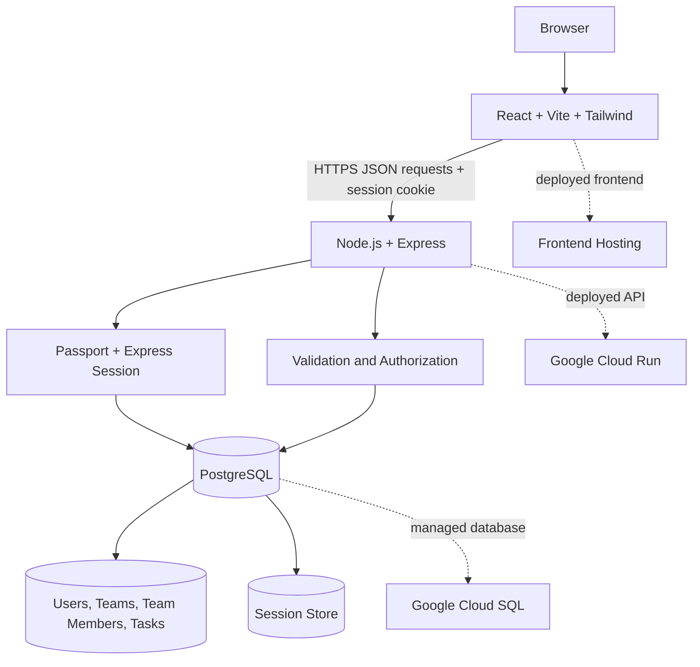
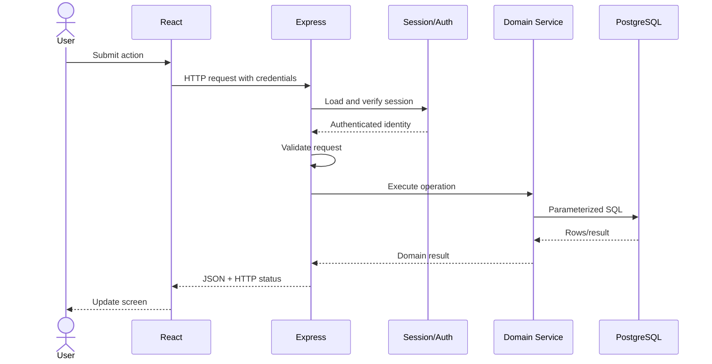

# System Architecture

## 1. Overview

The application uses a small monorepo with a React single-page application and an Express REST API backed by PostgreSQL.

The hosting topology is a recommended implementation. The assessment requires GCP deployment but does not mandate these exact GCP products.

## 2. Main components

### Frontend (`client/`)
- React pages and reusable UI components.
- React Router for page navigation.
- Tailwind CSS for responsive styles.
- A centralized API client configured with the API base URL and cookie credentials.
- Authentication state derived from the server's current-user endpoint.
- UI states: loading, empty, success, and failure.

### Backend (`server/`)
- Express app and middleware configuration.
- Passport Local Strategy for login.
- `express-session` for server-side sessions.
- PostgreSQL-backed session store in production.
- Route → controller → service → SQL separation.
- Joi or express-validator for request validation.
- Authentication, team membership and role authorization.
- Centralized error handling and safe logging.

### Database
- `users`: accounts and password hashes.
- `teams`: team metadata and creator.
- `team_members`: user-to-team relationship and role.
- `tasks`: team-owned tasks, creator, assignee and status.
- `session`: rows managed by the session-store package.

## 3. Request lifecycle

## 4. Domain rules

- A user can belong to multiple teams.
- A team can contain multiple users.
- A task belongs to exactly one team.
- A task may have no assignee; if assigned, that user must be a member of the task's team.
- Only authorized users can edit or delete teams and tasks.
- Every query must be scoped to the authenticated user's permitted data.
- A frontend route guard does not replace backend authorization.

## 5. Backend code responsibilities

- **Routes:** URLs, HTTP methods, middleware order.
- **Controllers:** parse validated inputs, call services, set status codes and responses.
- **Services:** domain rules and authorization-sensitive operations.
- **Database module:** pooled connection and parameterized SQL.
- **Validation schemas:** validate body, params and query.
- **Middleware:** authentication, membership checks, error responses.

## 6. API conventions

- Prefix: `/api`.
- JSON request and response bodies.
- Use `201 Created` for successful creation.
- Use `200 OK` for successful reads/updates and `204 No Content` for successful deletes where appropriate.
- Use `400` for invalid input, `401` for unauthenticated requests, `403` for denied actions, `404` for absent/inaccessible resources as appropriate, `409` for conflicts, and `500` for unexpected errors.
- Return a consistent error shape, e.g. `{ "error": { "code": "VALIDATION_ERROR", "message": "Request validation failed" } }`.
- Never return password hashes or session secrets.

## 7. Recommended frontend state approach

Start with React state and a small AuthContext. Do not add a global state library unless real complexity requires it. Fetch server-owned data from the API and handle refresh/invalidation explicitly after mutations.

## 8. Deployment boundaries

- Frontend static hosting serves the built client.
- Express API runs on Cloud Run or an equivalent suitable GCP runtime.
- PostgreSQL runs on Cloud SQL or another GCP-supported PostgreSQL service.
- Store secrets in an appropriate secret manager or deployment secret configuration.
- Use HTTPS and production-safe cookie configuration.
- Apply migrations as a controlled release step.
