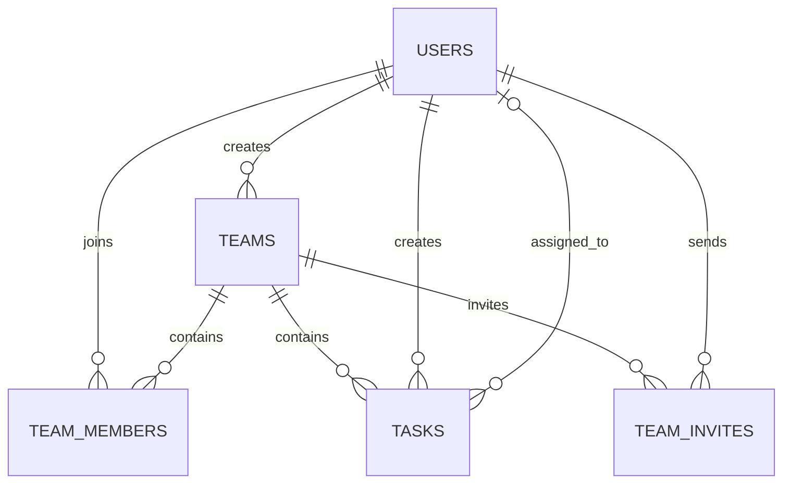

# Database Design

## 1. Database choice

Use PostgreSQL. The assessment allows a database service available on Google Cloud Platform and requires the deployed application to be on GCP.

Use SQL migrations so the schema is repeatable across local and production environments. The examples below are a design baseline; adapt naming to the codebase before applying migrations.

## 2. Entity relationship



## 3. Suggested schema

```sql
CREATE TABLE users (
  id BIGSERIAL PRIMARY KEY,
  name TEXT NOT NULL CHECK (length(trim(name)) BETWEEN 1 AND 100),
  email TEXT NOT NULL UNIQUE,
  password_hash TEXT NOT NULL,
  created_at TIMESTAMPTZ NOT NULL DEFAULT NOW(),
  updated_at TIMESTAMPTZ NOT NULL DEFAULT NOW()
);

CREATE TABLE teams (
  id BIGSERIAL PRIMARY KEY,
  name TEXT NOT NULL CHECK (length(trim(name)) BETWEEN 1 AND 120),
  description TEXT NOT NULL DEFAULT '',
  created_by BIGINT NOT NULL REFERENCES users(id) ON DELETE RESTRICT,
  created_at TIMESTAMPTZ NOT NULL DEFAULT NOW(),
  updated_at TIMESTAMPTZ NOT NULL DEFAULT NOW()
);

CREATE TABLE team_members (
  team_id BIGINT NOT NULL REFERENCES teams(id) ON DELETE CASCADE,
  user_id BIGINT NOT NULL REFERENCES users(id) ON DELETE CASCADE,
  role TEXT NOT NULL DEFAULT 'member' CHECK (role IN ('owner', 'member')),
  joined_at TIMESTAMPTZ NOT NULL DEFAULT NOW(),
  PRIMARY KEY (team_id, user_id)
);

CREATE TABLE tasks (
  id BIGSERIAL PRIMARY KEY,
  team_id BIGINT NOT NULL REFERENCES teams(id) ON DELETE CASCADE,
  title TEXT NOT NULL CHECK (length(trim(title)) BETWEEN 1 AND 200),
  description TEXT NOT NULL DEFAULT '',
  assigned_to BIGINT REFERENCES users(id) ON DELETE SET NULL,
  created_by BIGINT NOT NULL REFERENCES users(id) ON DELETE RESTRICT,
  status TEXT NOT NULL DEFAULT 'todo'
    CHECK (status IN ('todo', 'in_progress', 'done')),
  due_date DATE,
  created_at TIMESTAMPTZ NOT NULL DEFAULT NOW(),
  updated_at TIMESTAMPTZ NOT NULL DEFAULT NOW()
);

CREATE INDEX idx_team_members_user_id ON team_members(user_id);
CREATE INDEX idx_tasks_team_id ON tasks(team_id);
CREATE INDEX idx_tasks_assigned_to ON tasks(assigned_to);
CREATE INDEX idx_tasks_status ON tasks(status);
CREATE INDEX idx_tasks_created_at ON tasks(created_at);
```

### Important invariant: assignee must belong to task team

The simple schema above cannot enforce this rule with its current foreign keys alone. Validate it transactionally in the service, or strengthen the schema using a composite foreign key that references `team_members(team_id, user_id)`.

For a stronger database-level invariant, make `assigned_to` nullable and add a composite constraint after ensuring the schema and deletion behavior support it:

```sql
ALTER TABLE tasks
  ADD CONSTRAINT fk_task_assignee_is_team_member
  FOREIGN KEY (team_id, assigned_to)
  REFERENCES team_members(team_id, user_id)
  MATCH SIMPLE;
```

With `MATCH SIMPLE`, the composite constraint is not checked when `assigned_to` is null. Confirm member-removal behavior before adding this constraint: removing a member assigned to existing tasks requires a defined policy (for example, unassign those tasks first). Use a transaction to avoid partial updates.

### Invitations (BONUS-03)

`002_team_invites.sql` adds the table that backs the invitation stub. There is
no mail server in this build, so an invitation is a record instead of a
message.

```sql
CREATE TABLE team_invites (
  id BIGSERIAL PRIMARY KEY,
  team_id BIGINT NOT NULL REFERENCES teams(id) ON DELETE CASCADE,
  email TEXT NOT NULL CHECK (length(trim(email)) BETWEEN 3 AND 320),
  invited_by BIGINT NOT NULL REFERENCES users(id) ON DELETE CASCADE,
  status TEXT NOT NULL DEFAULT 'pending' CHECK (status IN ('pending', 'accepted', 'revoked')),
  created_at TIMESTAMPTZ NOT NULL DEFAULT NOW(),
  accepted_at TIMESTAMPTZ
);

CREATE UNIQUE INDEX idx_team_invites_pending_unique
  ON team_invites(team_id, email)
  WHERE status = 'pending';
```

- The partial unique index allows one pending invitation per team and address,
  while the accepted and revoked rows stay in the table as a history.
- The invitation becomes a membership in one transaction when the invited
  address registers or signs in, so an invitation is never marked as accepted
  without the membership existing.

## 4. Email normalization

Normalize emails consistently at registration and login, for example by trimming whitespace and lowercasing. Store a unique normalized value. Do not apply provider-specific transformations such as removing dots or `+tags`.

## 5. Session table

Use `connect-pg-simple` or the selected PostgreSQL session-store package to create/manage its session table. Follow the installed package's supported schema and initialization behavior; do not invent a session schema that is incompatible with it.

## 6. Migrations and seed data

- Store ordered migrations in `server/src/db/migrations/`.
- Apply migrations locally before starting the application.
- Use a seed script only for safe local demo data.
- Never seed default production credentials.
- Record migration rollback or recovery steps where practical.
- Run migrations deliberately during deployment, not on every incoming HTTP request.

## 7. Query safety and transactions

- Use `pg` parameterized queries (`$1`, `$2`, etc.).
- Never interpolate user-controlled values into SQL.
- Whitelist dynamic sort columns and directions.
- Use transactions for multi-step operations such as creating a team and adding its owner, or removing a member and unassigning tasks.
- Scope task queries to teams the current user can access.
