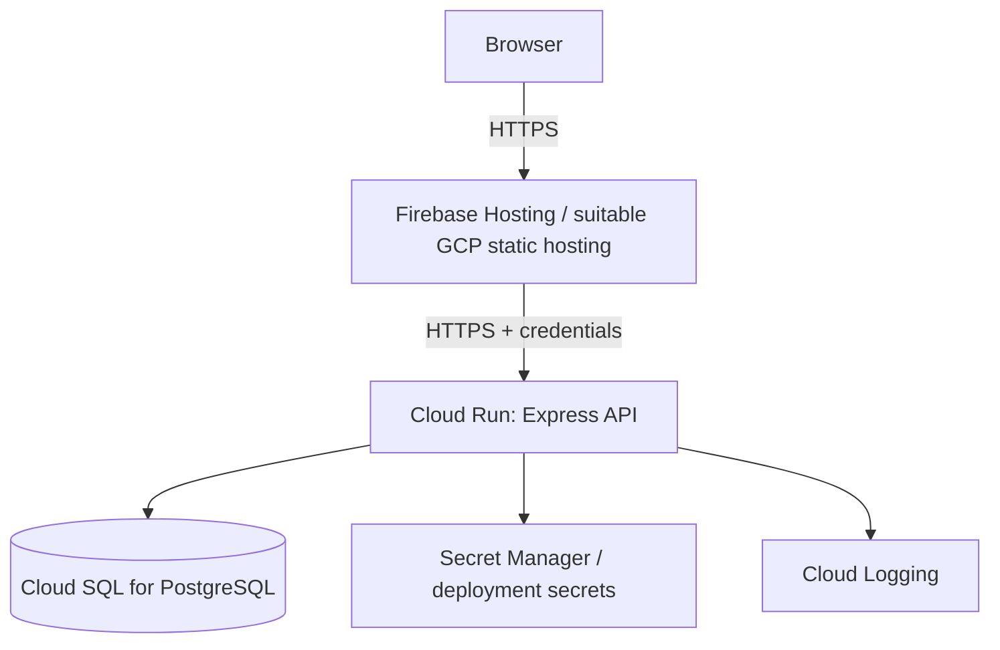

# Google Cloud Platform Deployment

The assessment requires a deployed version on GCP. This guide proposes a straightforward deployment: static frontend hosting, Express API on Cloud Run, and PostgreSQL on Cloud SQL. Confirm current product availability, pricing, quotas and setup screens in the official GCP console before proceeding.

## 1. Target topology



This topology is a recommendation; the assessment does not mandate these exact products.

## 2. Before deployment

- [ ] Create/select a GCP project.
- [ ] Confirm billing requirements and budget alerts.
- [ ] Choose a region supported by the required services.
- [ ] Enable only the required APIs.
- [ ] Create PostgreSQL database/user with least privilege.
- [ ] Prepare production secrets outside source control.
- [ ] Decide the frontend and API domains/origins.
- [ ] Verify session-cookie and CSRF strategy for those domains.

## 3. Database

1. Create a Cloud SQL PostgreSQL instance or another suitable GCP PostgreSQL service.
2. Create the application database and least-privilege application user.
3. Configure Cloud Run connectivity using a supported Cloud SQL connection method.
4. Store credentials securely.
5. Apply migrations as a release step.
6. Verify the API can connect from Cloud Run.
7. Ensure the session-store table is initialized using the selected package's supported process.

Do not expose PostgreSQL publicly unless required and secured. Prefer private or managed connectivity supported by the selected architecture.

## 4. Backend on Cloud Run

Prepare a production start command and ensure the server listens on the runtime-provided `PORT`:

```js
const port = process.env.PORT || 5000;
app.listen(port, "0.0.0.0");
```

Use the actual app/server structure; do not create a second listener if one already exists.

Configure:
- `NODE_ENV=production`
- `DATABASE_URL` or documented Cloud SQL connection settings
- `SESSION_SECRET`
- `CLIENT_ORIGIN`
- Other required non-secret settings
- Secret values via Secret Manager or supported deployment secret bindings

Check:
- Health endpoint responds.
- Database connectivity works.
- Logs contain no secrets.
- Session store persists sessions.
- Cookies are secure in production.
- CORS only allows intended frontend origins.
- CSRF defenses work with the deployed cookie setup.

## 5. Frontend hosting

1. Configure `VITE_API_URL` to the live API URL before building.
2. Run the frontend production build.
3. Deploy the generated static output using the selected GCP-compatible hosting service.
4. Configure SPA rewrites so client-side routes load correctly.
5. Verify the deployed site uses HTTPS and calls the correct API.

`VITE_` values are public browser bundle configuration; never put secrets in them.

## 6. Production cookie checklist

- `httpOnly: true`
- `secure: true`
- Finite `maxAge`
- Deliberate `sameSite`
- Correct cookie path/domain if configured
- Session ID regenerated after login
- Session destroyed at logout
- CORS credentials configured correctly
- CSRF defenses tested

If the frontend and backend are cross-site, cookies may require `SameSite=None; Secure`, and browser restrictions can still interfere. Test in a real browser, not only with API tools.

## 7. Release smoke test

Using the public frontend:
1. Register a fresh test account.
2. Log in.
3. Create a team.
4. Add a second registered user.
5. Create and assign a task.
6. Filter by team and assignee.
7. Update and delete a task.
8. Log out.
9. Confirm protected data cannot be accessed without a session.

## 8. Cost and cleanup

GCP hosting and managed PostgreSQL can incur costs. Check current pricing, quotas and billing before provisioning. Configure budget alerts where available. Do not promise that the entire topology is free. If the assessment deadline is near, deploy the simplest architecture that satisfies the requirement and can be verified.
