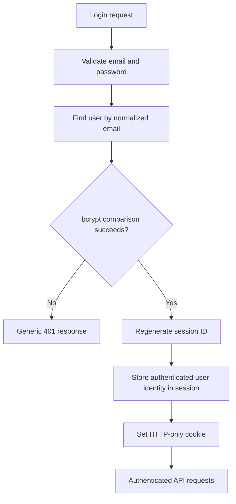

# Authentication and Security

This document defines the security baseline for the assessment. Security must be implemented in the API, not only in the React interface.

## 1. Authentication stack

- Passport.js with `passport-local`.
- bcrypt for password hashing and verification.
- `express-session` for server-side sessions.
- `connect-pg-simple` for PostgreSQL session persistence in deployed environments.
- HTTP-only session cookie.

The assessment's PDF spells the authentication library name as “PasswortJS”; this guide interprets it as Passport.js.

## 2. Login flow

Do not store the raw password or a password hash in the session. Store only the minimum user identity needed by Passport/session serialization.

## 3. Session configuration checklist

- Set a long random `SESSION_SECRET` through environment/secret configuration.
- Set `httpOnly: true`.
- Set `secure: true` in production HTTPS deployments.
- Choose `sameSite` according to actual frontend/API deployment topology.
- Set a finite session lifetime and appropriate cookie max age.
- Use PostgreSQL-backed session storage in production.
- Use memory storage only as an explicit local-development fallback if needed.
- Regenerate the session after login to mitigate session fixation.
- Destroy the session on logout and clear the cookie with matching path/domain/same-site options.
- Avoid logging cookie values or session IDs.

## 4. CORS, cookies and CSRF

For cross-origin cookie requests:
- Frontend fetch must use `credentials: "include"` (or Axios `withCredentials: true`).
- Express CORS must specify the exact trusted frontend origin, not `*`, when credentials are enabled.
- Set `credentials: true` in CORS configuration.
- Use HTTPS in production.
- Cross-site cookies generally require `SameSite=None; Secure`, and browser restrictions may still apply.
- Implement CSRF protection for state-changing requests, using a suitable token/origin-check approach compatible with the chosen session setup.
- Avoid changing state through GET requests.

A same-site deployment setup can simplify cookie handling, but still needs deliberate CORS and CSRF decisions.

## 5. Authorization model

Recommended baseline:
- `owner`: creates team; may update/delete the team and manage members.
- `member`: can view team tasks and create/update tasks according to the application's chosen policy.

Define and document the task mutation policy. A reasonable small-project rule is that team members may create tasks, while creators/owners or authorized members may update/delete them. Enforce the rule in services for every request.

The policy that is implemented:

- Any member of a team may create a task in that team.
- A task may be changed or deleted by the member who created it and by the owner of its team. Every other member of the team may read the task but not change it.
- A task always stays in the team it was created in. The `teamId` of a task is immutable, so the team and assignee rules cannot be broken by moving a task.
- The assignee of a task must be a member of the same team. The check runs in the task service and is enforced a second time by the `fk_task_assignee_is_team_member` constraint.
- A member of a team cannot leave the team by removing themselves from the owner role, and the owner cannot leave their own team: a team without an owner could never be managed or deleted again.
- A task of a team the caller does not belong to is reported as 404, so its existence stays concealed. A member who may see the task but not change it gets 403.

Never rely on hiding a button as access control.

## 6. Input and data safety

- Validate all incoming data using Joi or express-validator.
- Trim and bound strings.
- Validate IDs as positive integers.
- Whitelist allowed task statuses and update fields.
- Parameterize every SQL query.
- Do not build SQL from untrusted strings.
- Escape user-provided text at the appropriate output context; do not treat input sanitization as a substitute for output encoding.
- Use request body size limits.
- Set suitable security headers with Helmet.
- Add rate limiting to authentication endpoints if time permits.
- Use generic login failure responses.
- Do not leak whether a private resource exists when concealment is appropriate.

## 7. Secrets and production settings

- Keep `.env` files out of Git.
- Commit `.env.example` with placeholders only.
- Store production secrets in GCP Secret Manager or supported deployment secrets.
- Use a dedicated least-privilege database user.
- Do not commit service-account JSON keys.
- Do not expose server secrets through `VITE_` variables; Vite variables are bundled into the browser.
- Disable verbose stack traces in production.

## 8. Minimum security tests

- Unauthenticated access to protected endpoints returns 401.
- Incorrect password does not create an authenticated session.
- Logout invalidates the session.
- User A cannot access User B's private team/task resources.
- A non-owner cannot delete a team.
- A task cannot be assigned to a user outside that team.
- Invalid IDs, statuses and oversized inputs are rejected.
- Duplicate email registration is handled safely.
- SQL-like input does not alter query structure.
